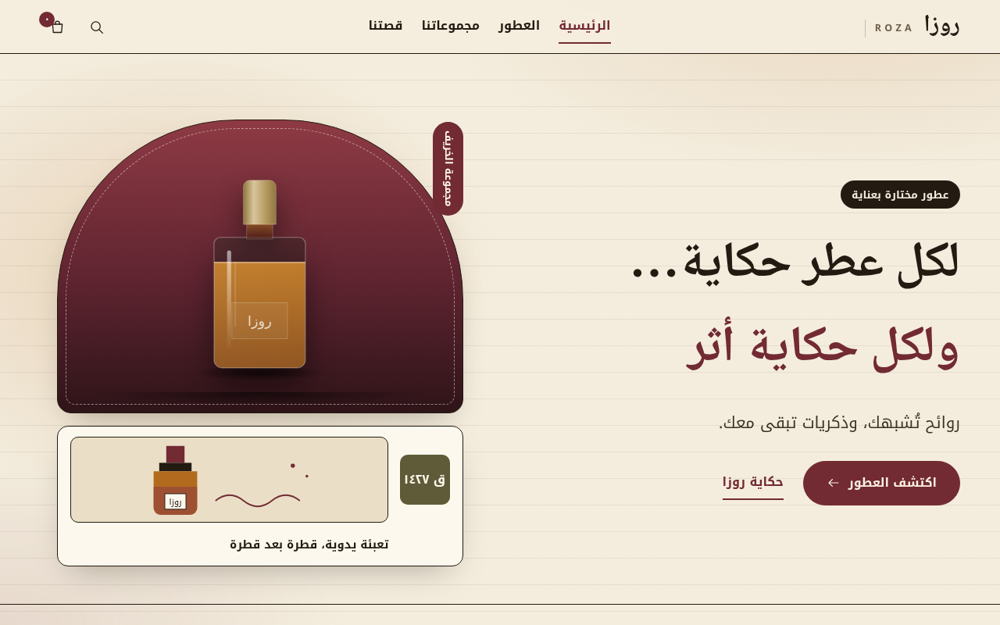
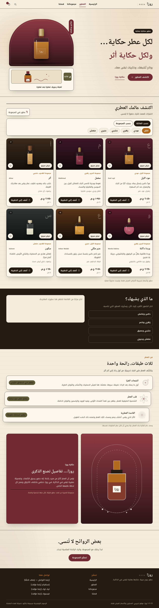
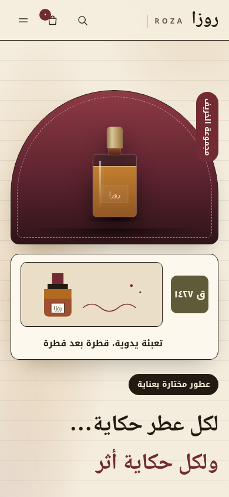

# ROZA · روزا — Arabic Perfume Storefront (v2 apothecary ledger)

A single-file, frontend-only demo boutique for Arabic perfumes — fully **offline**, light parchment RTL experience in pure HTML + CSS + JS (no build step, no dependencies, no network requests).

> `index.html` is the v2 redesign. The original dark-luxe version is preserved as `index-classic.html`.

## ✨ What's inside

- **Hero** — apothecary arch with code-drawn bottle, ledger-card motif
- **Collection** — 6 fragrances (عود الليل، مخمل، أثر، وردة داكنة، عنبر ملكي، سكون) with family/collection filters + live search
- **Mood finder** — dark ink panel, pick a vibe (دافئ، زهري، خشبي، منعش) and get curated picks
- **Notes ledger** — staggered top/heart/base layer cards with time pills
- **Product modal** — notes pyramid, size, price (EGP), favorites
- **Cart drawer** — add/remove quantities, totals, Arabic-Indic numerals, toasts
- **Story + footer** — maroon panel narrative, code-drawn art, navigation
- Fully **responsive** (desktop / tablet / mobile) + `prefers-reduced-motion` support, keyboard accessible

## 🚀 Run it (offline)

Just open it — no server, no internet needed:

```bash
xdg-open index.html
# or
python3 -m http.server 8000
# then visit http://localhost:8000
```

## 🖼️ Screenshots

| Desktop hero (1280px) | Full page | Mobile (390px) |
|---|---|---|
|  |  |  |

Screenshots captured headlessly with Chrome/Playwright from the exact `index.html` in this repo.

## 🛠️ Tech

- Single `index.html` (~74 KB): embedded CSS + JS, **zero external requests**
- System Arabic font stack (Noto Kufi/Naskh Arabic fallbacks) — no webfonts
- All art drawn as inline SVG (bottles, arches, ledger motifs) — no image assets
- State in vanilla JS (`PRODUCTS`, `MOODS`, cart Map, favorites Set)

## 📄 Note

Demo storefront with sample content — no backend, checkout is illustrative only.
